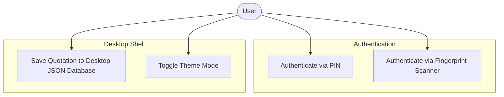
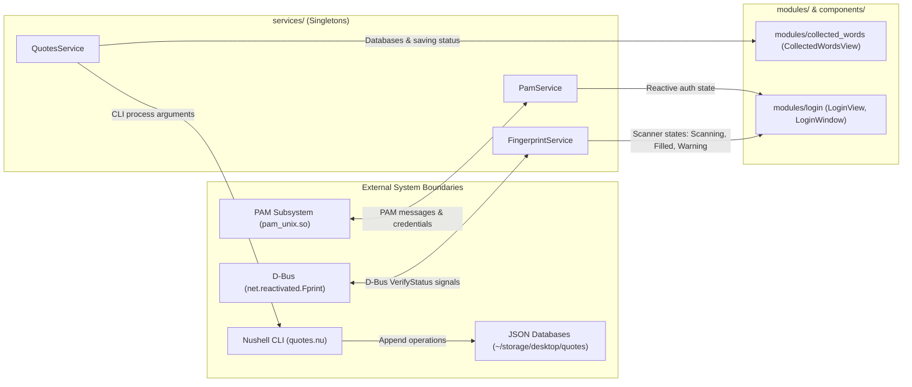

<!-- markdownlint-disable MD033 -->

# 007: Architecture

- **Type:** Architecture
- **Status:** **Accepted**
- **Date:** 2026-10-28
- **Author(s) / Deciders:** [João V. Farias](https://github.com/BeyondMagic)
- **Question:** How is the system decomposed into components, data flows, and directory structures, and which diagrams document its design?

## Context

Wisp is a desktop shell built on Quickshell and Hyprland. To maintain long-term maintainability and prevent monolithic QML files, the architecture separates system-level I/O processes from UI widgets through reactive singleton services, design system primitives, and feature modules.

## Required Visualizations

### 1. UML Use-Case Diagram



### 2. Data-Flow Diagram (DFD)



## Requirements and Restrictions

- **Tech Stack and Runtime:**
  - Shell engine: [Quickshell](https://quickshell.org/) (QtQuick / QML)
  - Wayland compositor: [Hyprland](https://hypr.land/)
- **Module Resolution:**
  - Quickshell automatically synthesizes module mappings under the `qs` namespace relative to the directory containing `shell.qml` (the config root).
  - All files in subdirectories access modules using clean dotted imports (for example, `import qs.services`, `import qs.config`, `import qs.components.controls as Controls`).
  - Running standalone entry points directly from subdirectories changes the config root, so root wrapper entrypoints remain in `source/` (`source/login.qml`, `source/collected-words.qml`).
- **External Boundaries:**
  - D-Bus system bus (`net.reactivated.Fprint` on `/net/reactivated/Fprint/Device/0`).
  - Linux PAM (`pam.d/qs-login`).
  - Local process invocations (`nu`, `fprintd-list`, `fprintd-verify`).

## Alternatives

- **Aylur's GTK Shell (AGS) / Astal:** Used in the previous version of the shell; replaced by Quickshell for QtQuick scene-graph performance and reactive QML bindings.
- **Monolithic QML Files:** Housing all window definitions, process invocations, and layout code in individual single-file entry points; rejected due to tight coupling, duplicate SVG icons, and untestable system logic.
- **Relative Path Imports (`../../`):** Importing components via relative file paths; rejected because relative paths break when files move and trigger Language Server Protocol warnings when crossing boundaries. Quickshell synthesized `qs.*` imports provide clean, portable references.

## Decision

Adopt a layered, modular directory structure under `source/`:

```text
source/
├── shell.qml                 # Composition root entrypoint
├── login.qml                 # Standalone login runner
├── collected-words.qml       # Standalone collected words runner
├── config/                   # Configuration and appearance singletons
│   ├── Config.qml            # Global settings and database paths
│   └── Theme.qml             # Semantic color tokens and dark mode toggle
├── utils/                    # Stateless utility singletons
│   └── Icons.qml             # Vector SVG assets and URI helpers
├── services/                 # Reactive system singletons
│   ├── PamService.qml        # PAM authentication lifecycle
│   ├── FingerprintService.qml# fprintd detection and D-Bus scanner states
│   └── QuotesService.qml     # Nushell process execution and JSON registry
├── components/               # Reusable UI primitives
│   ├── controls/             # Input and button primitives
│   │   ├── Button.qml        # Styled action button
│   │   ├── Dropdown.qml      # Select popup menu
│   │   ├── SvgIcon.qml       # Image SVG wrapper
│   │   └── TextInput.qml     # Text input with icon and error styling
│   ├── containers/           # Layout frames
│   │   └── Card.qml          # Bordered canvas container
│   └── effects/              # Animation helpers
│       └── ShakeEffect.qml   # Horizontal shake animation
└── modules/                  # Feature implementations
    ├── login/                # Authentication overlay
    │   ├── FingerprintIndicator.qml
    │   ├── LoginView.qml
    │   └── LoginWindow.qml
    └── collected_words/      # Quote maker window
        ├── QuoteInputRow.qml
        ├── CollectedWordsView.qml
        └── CollectedWordsWindow.qml
```

### Architectural Principles

1. **System Calling Isolation:** Modules under `modules/` never directly instantiate `Process`, `Socket`, or `PamContext`. All system interactions are encapsulated inside `services/`.
2. **Implicit Directory Imports:** Sibling components in the same directory starting with an uppercase letter are available without import statements.
3. **Synthesized `qs` Namespace:** Dotted imports like `import qs.services` or `import qs.modules.login` resolve to subfolders relative to `source/`.
4. **Thin Root Launchers:** Root entry points in `source/` load their respective window components from `modules/`, maintaining `source/` as the configuration root.

## Consequences

### Positives

- UI components remain stateless, predictable, and easy to preview in isolation.
- System services can be updated or swapped without touching layout code.
- Zero-warning QML compilation with Quickshell 0.3.2.

### Negatives

- Additional files to navigate compared to monolithic scripts.
- Multi-word directory names must use valid QML identifiers (snake_case) to avoid import parsing errors.
