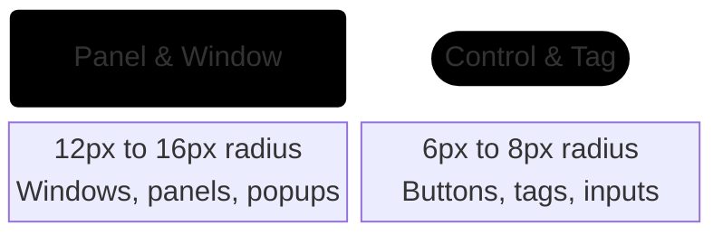

<!-- markdownlint-disable MD033 -->

# 009: Visual Identity and UI Design System

- **Type:** Design
- **Status:** Accepted
- **Date:** 2026-09-26
- **Author(s) / Deciders:** João V. Farias
- **Question:** What visual identity, logo variations, typography, color palette, and UI tokens represent the project across web, documentation, and user interfaces?

## Context

I need a clear visual direction for the project. The old shell worked, but the visuals were thrown together as I went. For this rewrite, I want a minimalist dark interface inspired by GNOME and Apple: clean curves, pure black backgrounds, and strong typography.

This record covers the visual foundation: branding assets, color palette, surfaces, type scales, opacity levels, and how clickable items look. Interaction flows and UX behavior are covered in [010: UX Paradigm and Flows](./010-ux-paradigm.md).

## Requirements and Restrictions

- Pure black background for deep contrast and low power use on OLED screens;
- Light typography over dark surfaces, using white text with varying opacity;
- Rely on font weight, size, and opacity to show hierarchy and clickability instead of heavy borders, badges, or saturated background colors;
- Strictly monochrome for the interface chrome and text, reserving color for critical system warnings or errors (while documentation uses the `#60CDEA` cyan brand accent);
- Crisp legibility at small sizes on the top bar and larger widget scales.

## Alternatives

- **Unbranded System Defaults:** Relying on standard GTK/Qt defaults minimizes design effort but lacks visual cohesion and OLED black contrast.
- **High-Saturation Accent Chrome:** Using colored borders, backgrounds, and badges across panels draws attention away from user content and increases visual noise.
- **Monochrome Opacity-Driven Hierarchy:** Uses pure black surfaces and white opacity tiers for quiet, legible hierarchy.

## Decision

I am setting the visual identity and UI design system rules as follows:

### Branding Assets

Repository and documentation branding assets reside under `documentation/content/assets/` organized by lockup type and target size:

- **Favicon and Icon Mark (`assets/favicon/`):** Multi-resolution SVG icons (`16.svg`, `24.svg`, `32.svg`, `48.svg`, `64.svg`, `128.svg`, `180.svg`, `192.svg`, `400.svg`, `512.svg`, and `1024.svg`) in `#60CDEA` cyan. `assets/favicon/32.svg` serves as the browser favicon and `assets/favicon/48.svg` as the documentation navigation bar logo.
- **Logotype (`assets/logotype/`):** Stacked icon mark and wordmark lockup in `91.81.svg` (`159x158`), `128.svg` (`259x259`, used for documentation and repository hero headers), and `400.svg` (`687x687`). Rendered in monochrome black and inverted automatically in dark mode via `filter: invert(1)`.
- **Wordmark (`assets/wordmark/`):** Horizontal wordmark lockup in `91.81.svg` (`158x47`), `128.svg` (`220x66`), and `400.svg` (`687x218`), also inverted in dark mode.
- **Decorative Patterns (`assets/`):** `assets/block_heart_pattern.svg` and `assets/heart-pattern-grey.svg` (`48x48` repeating tile patterns used in the documentation footer).

### Shell Colors and Surfaces

- **Background:** Pure black (`#000000`) for screen backing, floating panels, and popups.
- **Borders:** Hairline border using low-opacity white (`rgba(255, 255, 255, 0.10)`). No solid gray borders.
- **Radii:** Rounded corners for windows and panels (`12px` to `16px`), with tighter radii for controls and tags (`6px` to `8px`).
- **Accent colors:** None in the main shell interface. Chrome, text, and icons stay grayscale. Subdued red (`#CF6679`) and amber (`#E5C07B`) are allowed only for critical errors and battery alerts.

```mermaid
block-beta
    columns 4
    bg_sq["&nbsp;"] bd_sq["&nbsp;"] err_sq["&nbsp;"] wrn_sq["&nbsp;"]
    bg_lbl["Background<br>#000000"] bd_lbl["Border<br>rgba(255, 255, 255, 0.10)"] err_lbl["Error<br>#CF6679"] wrn_lbl["Warning<br>#E5C07B"]

    style bg_sq fill:#000000,stroke:#333333,stroke-width:1px
    style bd_sq fill:#1A1A1A,stroke:#FFFFFF,stroke-width:1px
    style err_sq fill:#CF6679,stroke:#CF6679
    style wrn_sq fill:#E5C07B,stroke:#E5C07B
```

### Typography Hierarchy

Use a clean, neutral sans-serif with strong legibility at small sizes: **Inter**.

The type scale has five tiers:

- **Branding:** `32px` to `36px` (app name, splash screen)
- **Title:** `18px` to `20px` (clock, main headers)
- **Body:** `13px` to `14px` (standard labels, menu rows)
- **Caption:** `11px` to `12px` (subtitles, secondary info, timestamps)
- **Micro:** `9px` to `10px` (category titles, fine metadata)

### Opacity and Hierarchy

White text opacity against the black background indicates priority:

- **Primary (`100%` White, `#FFFFFF`):** Active headers, primary labels, current time.
- **Secondary (`70%` White, `#B3B3B3`):** Standard body text and unhighlighted labels.
- **Tertiary (`45%` White, `#737373`):** Subtitles, timestamps, and secondary hints.
- **Inactive (`25%` White, `#404040`):** Disabled actions, placeholders, and subtle dividers.

```mermaid
block-beta
    columns 4
    op_primary["&nbsp;"] op_sec["&nbsp;"] op_tert["&nbsp;"] op_dis["&nbsp;"]
    lbl_primary["Primary<br>100% White<br>#FFFFFF"] lbl_sec["Secondary<br>70% White<br>#B3B3B3"] lbl_tert["Tertiary<br>45% White<br>#737373"] lbl_dis["Inactive<br>25% White<br>#404040"]

    style op_primary fill:#FFFFFF,stroke:#FFFFFF
    style op_sec fill:#B3B3B3,stroke:#B3B3B3
    style op_tert fill:#737373,stroke:#737373
    style op_dis fill:#404040,stroke:#404040
```

### Clickable Elements

Interactive text stands out without cluttering the screen with button boxes:

- **Font weight:** Static labels use normal weight (`400`). Clickable items use medium (`500`) or semibold (`600`).
- **Idle state:** Clickable items rest at secondary opacity (around `75%`) with medium weight.
- **Hover state:** Brightens to full white (`100%`) on hover for immediate feedback.
- **Press state:** Dims slightly (around `85%`) or scales down by `2%` on mouse down.

### Styles and Decorations

- **Section headers:** Uppercase with wide letter spacing (`0.5px` to `1.0px`) at micro or caption size, using tertiary opacity.
- **Italics:** Kept only for placeholders or empty-state text.
- **Underlines:** No underlines on buttons or UI text. Used only for hyperlinks on hover.

## Consequences

### Positives

- The pitch-black surfaces and monochrome palette keep the shell clean, quiet, and easy on the eyes.
- Clear opacity and weight tiers make it obvious what is clickable without adding heavy button containers.
- Low power usage on OLED displays.
- Gives the desktop a cohesive look that matches modern GNOME and macOS styling.

### Negatives

- Low-opacity text (`45%` and `25%`) might be hard to read on low-end displays or under bright glare.
- A strictly monochrome interface means spacing and type weights have to do all the heavy lifting, leaving less room for sloppy layouts.

### References

- [dotfiles_nothing_os](https://github.com/0xbbuddha/dotfiles_nothing_os): A minimal, monochrome desktop shell for Linux with a similar aesthetic.
