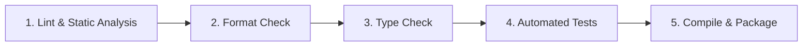

<!-- markdownlint-disable MD033 -->

# 012: CI/CD and Tooling

- **Type:** Operational
- **Status:** Planned
- **Date:** YYYY-MM-DD
- **Author(s) / Deciders:** DevOps engineers, maintainers, and build infrastructure leads
- **Question:** What static analysis, formatting rules, continuous integration quality gates, and automated delivery pipelines enforce project standards?

## Context

Automated quality gates prevent style disputes, syntax errors, and broken builds from reaching the shared codebase. Enforcing linters, code formatters, type checkers, and test execution through continuous integration guarantees that every pull request satisfies baseline technical standards before maintainer review.

## Static Analysis and Code Formatting

### Automated Formatting

- **Formatter Selection:** An automated code formatter (such as Prettier, Ruff, rustfmt, or clang-format) MUST be configured with repository defaults.
- **Zero-Tolerance Style Policy:** Code style disputes are resolved by the formatter configuration; manual style comments in pull request reviews are prohibited.

### Static Analysis and Linters

- **Linter Configuration:** High-performance static analysis tools (such as oxlint, ruff, clippy, or eslint) MUST run in strict mode with zero warnings allowed in production code.
- **Type Safety:** Static type checkers (such as tsc or mypy) MUST run in strict mode prior to test execution.

## Multi-Stage Quality Gate Pipeline

Continuous integration pipelines MUST execute the following sequential stages on every pull request:

1. **Lint and Static Analysis:** Detect syntax errors, unused variables, and dangerous code patterns.
2. **Format Verification:** Confirm all touched files match repository formatting rules without modifications.
3. **Type Checking:** Verify API interfaces and type signatures across module boundaries.
4. **Automated Tests:** Execute the unit and integration test suites defined in [011: Testing Strategy](./011-testing-strategy.md).
5. **Compilation and Build:** Verify that production binaries, packages, or documentation sites build cleanly with zero errors.

## Branch Protection and Merge Gates

- **Protected Branches:** The `master` / `main` branch MUST require passing CI checks and at least one human review before merging.
- **Commit Message Validation:** Commits MUST adhere to the [Conventional Commits](../glossary.md#conventional-commits) format to enable automated changelog generation.
- **Local Parity:** Developers and coding agents SHOULD be able to execute identical quality checks locally via task runners (for example, `.vscode/tasks.json` or package scripts) before pushing commits.

## Alternatives

- **Manual Code Review Only:** Code review without automated tooling wastes reviewer time on formatting, typos, and lint issues that machines catch instantly.
- **Post-Merge Broken Window Policy:** Merging without blocking gates allows broken builds to enter the main branch, blocking all downstream developers.

## Decision

Document the selected linters, formatters, type checkers, and GitHub Actions workflow configuration enforcing pull request validation.

## Consequences

### Positives

- Automated quality gates catch defects before human review, keeping code quality high.
- Local tooling parity ensures developers and coding agents can verify changes quickly before pushing.

### Negatives

- Strict CI gates can slow down urgent hotfixes if pipeline runtimes become excessive.

