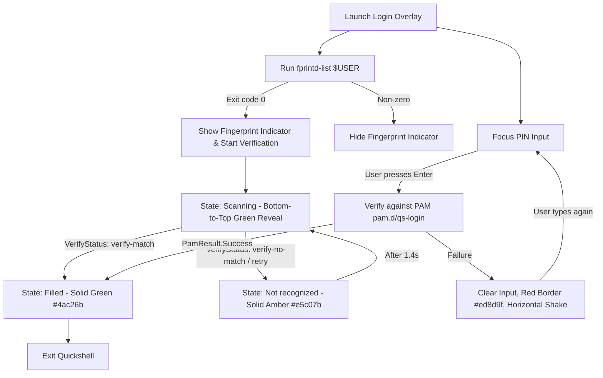
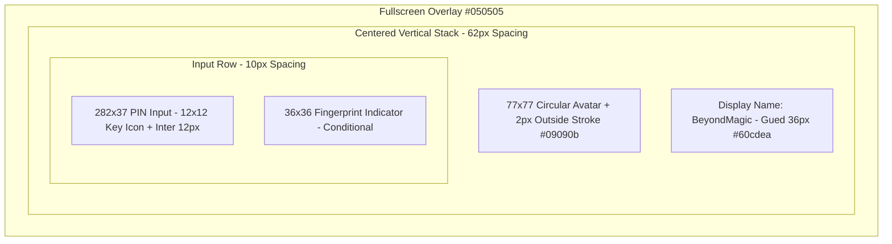

<!-- markdownlint-disable MD033 -->

# 001: Login

- **Status:** **Accepted**
- **Date:** 2026-10-25
- **Author(s):** [João V. Farias](https://github.com/BeyondMagic)

## Context

The login screen blocks desktop interaction behind an exclusive Wayland overlay until the user authenticates via PIN/password or a hardware fingerprint scanner. In its standalone form (`source/login.qml`) or within `source/shell.qml`, it projects fullscreen overlay panels across all connected displays (`Quickshell.screens`) via `Variants`, capturing keyboard and pointer events and exiting Quickshell upon successful verification.

## Interaction Flow

1. **Exclusive Input Capture & Multi-Monitor Support:**
   - The overlay uses Quickshell `Variants` bound to `Quickshell.screens` to instantiate an overlay `PanelWindow` on every connected monitor.
   - Each window renders on `WlrLayer.Overlay` with `ExclusionMode.Ignore` and `WlrKeyboardFocus.Exclusive`.
   - Mouse clicks and scroll wheel events outside controls are swallowed, and stray keystrokes redirect focus to the PIN input field.
   - PIN entry and authentication error states are synchronized across all screens, allowing input from any active monitor.

2. **Hardware Fingerprint Detection:**
   - On startup, the module executes `fprintd-list $USER`.
   - If the command exits with `0`, fingerprint authentication is enabled: the `36x36` fingerprint indicator appears `10px` to the right of the PIN input and begins verification in parallel with PIN entry.
   - If the command returns a non-zero exit code, the fingerprint indicator remains hidden and only the centered PIN input is shown.

3. **PIN Authentication & Error Feedback:**
   - Pressing `Enter` submits the entered secret to `PamContext` (`pam.d/qs-login`).
   - On failure, the input text is cleared immediately, the `1px` input border transitions to `#ed8d9f` (`status/error`), and the input box plays a horizontal shake animation. Typing again resets the border color to `#fafafa` at 10% opacity.

4. **Fingerprint Visual States:**
   - **Default:** `36x36` rounded box (`5px` radius, `1px` stroke `#f4f4f5` at 10% opacity) with a `24x24` `#fafafa` fingerprint icon.
   - **Scanning:** Base `#fafafa` fingerprint overlaid with a bottom-to-top clipped container revealing a counter-translated `#4ac26b` (`status/success`) fingerprint so the icon stays stationary while the green sweep rises and falls.
   - **Filled:** Full `#4ac26b` fingerprint upon match before exiting Quickshell.
   - **Not recognized:** Full `#e5c07b` (`status/warning`) fingerprint and `1px` `#e5c07b` border on a failed or incomplete scan, returning to `Scanning` after a short pause.

5. **Pre-Loaded Startup Lock & Instant Unlock:**
   - On boot, `getty@tty1` auto-logs in via `/etc/dinit.d/config/agetty-tty1.conf` (`--autologin terra --noclear`), invoking `nu --login` which runs `login.nu` and executes `start-hyprland` on `/dev/tty1`.
   - At `hyprland.start` (`exec/index.lua`), Hyprland immediately launches `sh -c 'until quickshell -p ~/.config/quickshell/login.qml; do sleep 0.2; done'`, covering all monitors (`Quickshell.screens`) in a crash-safe loop while desktop services (`ags`, `awww-daemon`, `fcitx5`, `xdg-desktop-portal`, `thunderbird`, `beeper`) preload in parallel behind the overlay.
   - Upon successful PIN or fingerprint verification, `PamService.finishSession()` stops active fingerprint processes and exits Quickshell with code `0` (`Qt.quit()`), terminating the `until` loop and revealing the pre-loaded desktop with zero compositor restart delay.

## Visual Design

- **Figma Design & Motion:** [Desktop - Login (`node-id=44-2059`)](https://www.figma.com/design/GS4qHgJ74LSMKBl9TAcRly/Desktop?node-id=44-2059&m=dev)

## Implementation

### Theme Tokens

| Token                   | Value                        | Usage                                         |
| :---------------------- | :--------------------------- | :-------------------------------------------- |
| `background/canvas`     | `#050505`                    | Fullscreen overlay background                 |
| `border/inverse`        | `#09090b`                    | `2px` outside stroke around the `77x77` avatar |
| `accent/blue`           | `#60cdea`                    | Display name (`Gued` Regular `36px`)          |
| `text/primary`          | `#fafafa`                    | PIN input text and base fingerprint icon      |
| `text/placeholder`      | `rgba(250, 250, 250, 0.60)`  | `"PIN"` placeholder (`Inter` Regular `12px`)  |
| `border/input`          | `rgba(250, 250, 250, 0.10)`  | Default `1px` inside border on PIN input      |
| `border/button`         | `rgba(244, 244, 245, 0.10)`  | Default `1px` inside border on Fingerprint    |
| `status/success`        | `#4ac26b`                    | `Scanning` reveal and `Filled` fingerprint    |
| `status/warning`        | `#e5c07b`                    | `Not recognized` fingerprint and border       |
| `status/error`          | `#ed8d9f`                    | PIN input border on failed authentication     |

### Two-Tier Fingerprint Scanner Integration

<!--
- [ ] Transform [`python-validity`, `fprintd-clients`](https://github.com/vowstar/vowstar-overlay) at commit `a967650c76ac438e05bdca8bd369213ccd7a4f24` ebuild to PKGBUILD.
- [ ] Transform [`sys-auth/fprintd`](https://anongit.gentoo.org/git/repo/gentoo.git) ebuild to PKGBUILD.
-->

Fingerprint state tracking uses a two-tier architecture so the UI responds to structured hardware events first while keeping a text-stream fallback:

1. **Primary Target (Method 2: D-Bus Signals):**
   - Subscribes to the `net.reactivated.Fprint` system bus on object path `/net/reactivated/Fprint/Device/0` (`gdbus monitor --system --dest net.reactivated.Fprint --object-path /net/reactivated/Fprint/Device/0`).
   - Listens to `VerifyFingerSelected` and `VerifyStatus` signals (`verify-match`, `verify-no-match`, `verify-retry-scan`, `verify-swipe-too-short`, `verify-finger-not-centered`, `verify-remove-and-retry`, `verify-unknown-error`, `verify-disconnected`) to drive `Scanning`, `Filled`, and `Not recognized` transitions directly.

2. **Fallback Target (Method 1: PAM & CLI Text Stream Parsing):**
   - If the D-Bus signal stream is unavailable, `PamContext.onPamMessage` and the `fprintd-verify` process streams (`SplitParser` on `stdout`/`stderr`) match prompt strings (`"Place your"`, `"Swipe your"`, `"Scanning"`, `"verify-match"`, `"verify-no-match"`, `"Failed"`, `"not recognized"`) to update the indicator state.
