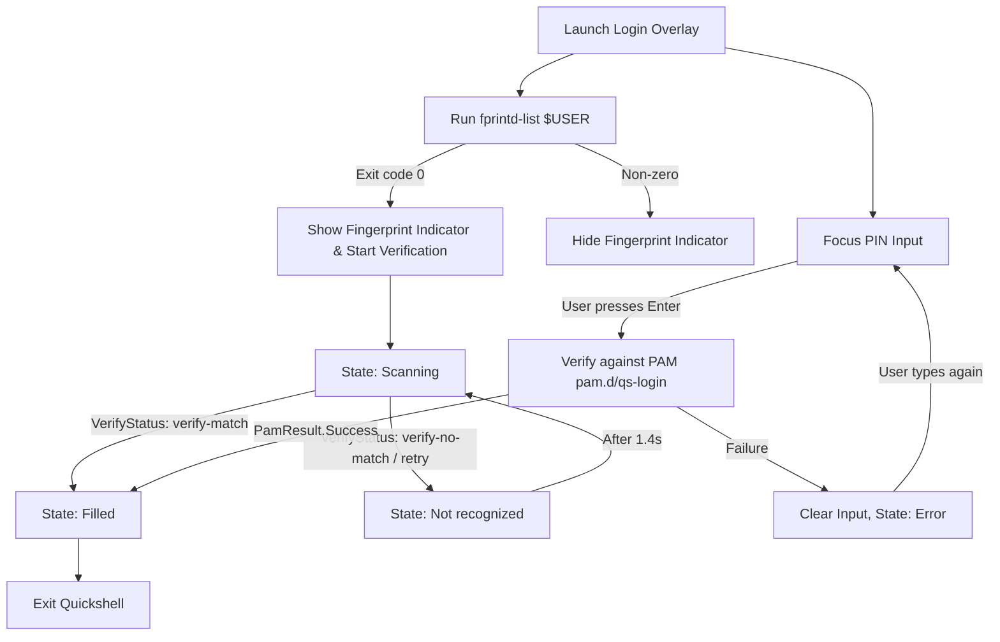

<!-- markdownlint-disable MD033 -->

# 001: Login

- **Status:** **Accepted**
- **Date:** 2026-10-25
- **Author(s):** [João V. Farias](https://github.com/BeyondMagic)

## Context

Standard display managers restart compositor sessions or delay desktop startup until authentication completes, creating a slow transition to the workspace. When returning to the machine, the user needs an immediate lock screen across every display that authenticates via password or fingerprint without restarting Hyprland.

<!--
AI Agent Context & Boot Sequence:
- Pre-Loaded Startup: On boot, getty@tty1 auto-logs in via `/etc/dinit.d/config/agetty-tty1.conf` (`--autologin <user> --noclear`), running `login.nu` which auto-executes `start-hyprland` on `/dev/tty1`.
- Hyprland immediately runs `sh -c 'until quickshell -p ~/.config/quickshell/login.qml; do sleep 0.2; done'`, covering all displays while background desktop services (ags, awww-daemon, fcitx5, xdg-desktop-portal, thunderbird, beeper) start in parallel.
- Upon successful authentication, `PamService.finishSession()` stops active fingerprint processes and calls `Qt.quit()`, terminating the until-loop and uncovering the pre-loaded desktop with zero compositor restart delay.
-->

## Interaction Flow

1. **Multi-Monitor Input Capture:**
   - The overlay covers all connected displays simultaneously.
   - Pointer and scroll events outside the input controls are ignored.
   - Stray keystrokes automatically redirect focus to the secret input.
   - Input text and error states stay synchronized across every monitor so authentication can occur on any active screen.

2. **Hardware Fingerprint Detection:**
   - On startup, the service checks for fingerprint hardware support.
   - If supported, the fingerprint indicator becomes visible next to the secret input and starts scanning in parallel with keyboard input.
   - If unsupported, the fingerprint indicator remains hidden.

3. **Password and PIN Verification:**
   - Pressing Enter submits the entered secret to PAM.
   - On success, the interface transitions to the Filled state and exits the overlay.
   - On failure, the input clears immediately, enters an Error state, and triggers a horizontal shake animation. Typing any character resets the Error state.

4. **Fingerprint Verification:**
   - Default: Idle resting state before verification starts.
   - Scanning: Active sensor awaiting touch.
   - Filled: Triggers immediately upon a successful fingerprint match, unlocking the session.
   - Not recognized: Displays on unmatched fingerprints or incomplete swipes for 1.4 seconds, then resets back to Scanning.

## Visual Design

<!-- Figma visual design export placeholder -->

## Implementation

### Two-Tier Fingerprint Scanner Integration

<!--
- [ ] Transform `python-validity`, `fprintd-clients` ebuilds to PKGBUILD.
- [ ] Transform `sys-auth/fprintd` ebuild to PKGBUILD.
-->

Fingerprint state tracking uses a two-tier architecture so the interface responds to structured hardware events first while keeping a text-stream fallback:

1. **D-Bus Signals:**
   - Subscribes to the `net.reactivated.Fprint` system bus on object path `/net/reactivated/Fprint/Device/0` via `gdbus monitor`.
   - Listens to `VerifyFingerSelected` and `VerifyStatus` signals (`verify-match`, `verify-no-match`, `verify-retry-scan`, `verify-swipe-too-short`, `verify-finger-not-centered`, `verify-remove-and-retry`, `verify-unknown-error`, `verify-disconnected`) to drive state transitions.

2. **Fallback Text Stream Parsing:**
   - If the D-Bus signal stream is unavailable, `PamContext.onPamMessage` and the `fprintd-verify` process streams (`SplitParser` on stdout and stderr) match verification keywords to update the indicator state.
