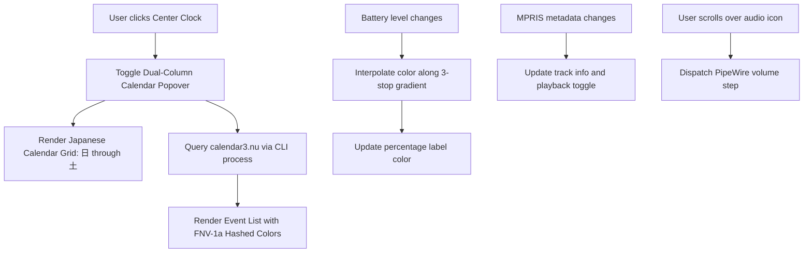
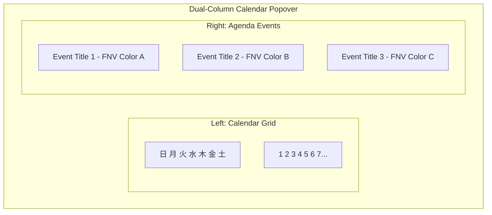

<!-- markdownlint-disable MD033 -->

# 003: System Tray

- **Status:** **Accepted**
- **Date:** 2026-10-24
- **Author(s):** [João V. Farias](https://github.com/BeyondMagic)

## Context

The system tray occupies the center and trailing sections of the top bar. It provides date and time tracking, calendar event inspection, hardware status monitoring (battery with linear color interpolation), StatusNotifierItem indicators, PipeWire volume adjustment, and MPRIS media playback controls.

## Benchmark

### Legacy `lovemii` Astal Shell

The legacy configuration divided system status into four modules:

- `widget/bar/date/text.ts`: formatted time as `%B%d%A###%I時%M分`, cycling kanji opacity between 35% and 75% on alternate seconds using Pango markup.
- `widget/bar/date/calendar.tsx`: rendered a dual-pane popover containing a Japanese-labeled calendar grid (`日`, `月`, `火`, `水`, `木`, `金`, `土`) and a synchronized Google Calendar agenda.
- `widget/bar/date/google.ts`: executed `calendar3.nu` to fetch event lists across a three-year window (`calendar3.nu events --calendar primary --time-min <start> --time-max <end> --json=true`).
- `widget/bar/menu/index.tsx`: monitored battery percentage via `gi://AstalBattery`, interpolating between three color stops (`#101657ff` deep navy, `#337eb5ff` cyan, `#d36799ff` magenta).

## Interaction Flow



1. **Clock Display & Kanji Opacity Cycle:**
   - The center bar displays the current date and time formatted in Japanese: month, day, weekday, hour, and minute.
   - Every second, kanji characters cycle their display opacity between 35% and 75% to produce a rhythmic pulse.

2. **Calendar Popover:**
   - Clicking the center clock toggles a dual-pane popover.
   - The left pane displays a month grid with Japanese weekday labels (`日`, `月`, `火`, `水`, `木`, `金`, `土`).
   - The right pane displays upcoming Google Calendar events retrieved asynchronously through `calendar3.nu`. Event title accents are deterministically colored using FNV-1a hashing.

3. **Status Indicators:**
   - **Battery:** Displays percentage text styled with a continuous color gradient from deep navy (low charge) through cyan (medium) to magenta (full charge). Desktops without a battery display a fallback menu icon.
   - **System Tray:** Hosts external application status icons using the standard `StatusNotifierItem` protocol.
   - **Audio & Media:** PipeWire controls volume levels on scroll and click, while MPRIS controls active local or streaming audio players.

## Visual Design



## Implementation

### Data Models

```json
{
  "clock": {
    "format": "%B%d%A###%I時%M分",
    "kanji_alpha_low": "35%",
    "kanji_alpha_high": "75%",
    "interval_ms": 1000
  },
  "battery_gradient": {
    "stops": [
      { "percentage": 0, "color": "#101657ff" },
      { "percentage": 50, "color": "#337eb5ff" },
      { "percentage": 100, "color": "#d36799ff" }
    ]
  },
  "calendar": {
    "provider_cli": "calendar3.nu",
    "calendar_id": "primary",
    "time_range_years": 3,
    "refresh_rate_ms": 60000
  }
}
```

### Color Interpolation Formula

Color transitions between adjacent gradient stops using component-wise linear interpolation:

\[
C = C_1 + (C_2 - C_1) \cdot \left(\frac{p - p_1}{p_2 - p_1}\right)
\]

where \(p\) is the current battery percentage, and \(C_1, C_2\) are RGBA channels of the enclosing stops.

### Quickshell Components

- **Clock & Kanji Pulse:** `Quickshell.Timer` fires every 1000ms. A JavaScript formatting helper formats the date string and applies alternating text opacity to Kanji Unicode ranges (`[\u4e00-\u9faf]`).
- **Calendar Grid:** QML `GridView` or `GridLayout` with day cells computed relative to GLib date math or JavaScript `Date`.
- **Event Fetching:** Quickshell `Process` launches `calendar3.nu events --calendar primary --time-min <min> --time-max <max> --json=true`, parsing results into a `ListModel`.
- **Battery Status:** `Quickshell.Services.UPower` or `/sys/class/power_supply` polling computes the interpolated hex color for the percentage text.
- **System Tray:** `Quickshell.Services.SystemTray` surfaces running `StatusNotifierItem` icons.
- **Audio & Media:** `Quickshell.Services.Pipewire` for audio sink control and `Quickshell.Services.Mpris` for player state.
