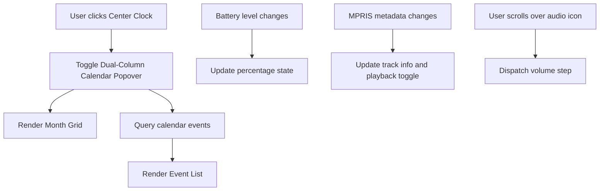

<!-- markdownlint-disable MD033 -->

# 003: System Tray

- **Status:** **Accepted**
- **Date:** 2026-10-24
- **Author(s):** [João V. Farias](https://github.com/BeyondMagic)

## Context

Minimalist Wayland status bars frequently require disjointed external tools or complex polling scripts to check the time, review calendar schedules, inspect battery levels, and manage audio devices. Switching across different standalone applets breaks focus during routine desktop work. The system tray unifies date tracking, calendar inspection, battery monitoring, system applet status, audio sink volume, and media playback controls in the persistent top bar.

<!--
AI Agent Context & Services:
- Legacy reference: `lovemii` astal bar (`widget/bar/date/`, `widget/bar/menu/index.tsx`).
- Backends: PipeWire for audio, MPRIS for media player control, UPower for battery charge tracking, and `calendar3.nu` for Google Calendar event synchronizations.
-->

## Interaction Flow



1. **Clock Display:**
   - Displays the current date and time formatted with month, day, weekday, hour, and minute.
   - Kanji characters alternate opacity on each second to indicate an active time pulse.

2. **Calendar Popover:**
   - Clicking the center clock opens or closes a dual-column popover.
   - The primary pane displays the selected month grid with weekday headers, highlighting the current day.
   - The secondary pane displays upcoming calendar events sorted chronologically.
   - Navigating months queries event intervals corresponding to the visible date range.

3. **Status Indicators:**
   - Battery: Displays current charge percentage and charging state. Devices without battery hardware show a generic system icon.
   - System Applets: Displays active external application icons via the StatusNotifierItem protocol. Clicking an icon opens its application menu or toggles its window.
   - Audio Volume: Scrolling over the audio indicator increments or decrements volume. Clicking toggles mute state.
   - Media Playback: Reflects playback status and current track metadata from active media players. Clicking toggles play and pause.

## Visual Design

<!-- Figma visual design export placeholder -->


## Implementation

### Data Models

```json
{
  "clock": {
    "format": "%B%d%A###%I時%M分",
    "interval_ms": 1000
  },
  "battery_gradient": {
    "stops": [
      { "percentage": 0, "color": "#101657ff" },
      { "percentage": 50, "color": "#337eb5ff" },
      { "percentage": 100, "color": "#d36799ff" }
    ]
  },
  "calendar": {
    "provider_cli": "calendar3.nu",
    "calendar_id": "primary",
    "time_range_years": 3,
    "refresh_rate_ms": 60000
  }
}
```

### Color Interpolation Formula

Color transitions between adjacent gradient stops using component-wise linear interpolation:

\[
C = C_1 + (C_2 - C_1) \cdot \left(\frac{p - p_1}{p_2 - p_1}\right)
\]

where \(p\) is the current battery percentage, and \(C_1, C_2\) are RGBA channels of the enclosing stops.

### Quickshell Components

- **Clock:** `Quickshell.Timer` fires every 1000ms. A JavaScript formatting helper formats the date string and applies alternating text opacity to Kanji characters.
- **Calendar Grid:** QML `GridView` or `GridLayout` with day cells computed relative to GLib date math or JavaScript `Date`.
- **Event Fetching:** Quickshell `Process` launches `calendar3.nu events --calendar primary --time-min <min> --time-max <max> --json=true`, parsing results into a `ListModel`.
- **Battery Status:** `Quickshell.Services.UPower` or `/sys/class/power_supply` polling computes the interpolated hex color for the percentage text.
- **System Applets:** `Quickshell.Services.SystemTray` surfaces running `StatusNotifierItem` icons.
- **Audio and Media:** `Quickshell.Services.Pipewire` for audio sink control and `Quickshell.Services.Mpris` for player state.
