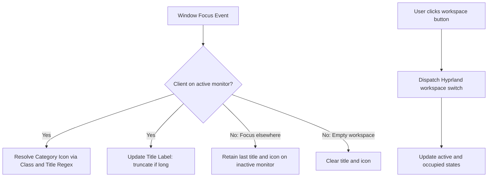

<!-- markdownlint-disable MD033 -->

# 004: Workspace Tray

- **Status:** **Accepted**
- **Date:** 2026-10-24
- **Author(s):** [João V. Farias](https://github.com/BeyondMagic)

## Context

Multi-monitor workflows make it difficult to identify which virtual workspace is active on each display, which application currently holds focus, or whether background workspaces contain running windows. Users often switch to the wrong workspace or lose track of active windows when navigating across monitors. The workspace tray provides per-monitor virtual desktop navigation, active application category identification, and focused window title tracking within the persistent top bar.

<!--
AI Agent Context & Architecture:
- Migrated from legacy Astal implementation in `lovemii` (`widget/bar/workspaces`, `widget/bar/icon`, `widget/bar/title`, `widget/corner`).
- Hyprland IPC provides client focus and workspace state updates.
- Window class names match against regex categories to select symbolic icons.
-->

## Interaction Flow



1. **Workspace Navigation:**
   - The bar renders 10 fixed workspace buttons per monitor.
   - Workspaces reflect three distinct states: Empty, Occupied (containing open windows), and Active (currently selected workspace).
   - Clicking any workspace button switches Hyprland focus to that workspace on the active display.

2. **Window Metadata:**
   - When window focus changes, the active window class and title match against the category mapping table to select a symbolic application icon.
   - The window title label reflects the active window title, truncating with an ellipsis when exceeding available bar space.
   - When focus moves to another monitor, the inactive monitor freezes its last known title and icon rather than clearing abruptly. When a workspace is empty, the title and icon clear.

3. **Display Framing:**
   - Four corner masks anchor to the display corners to provide rounded screen borders framing the desktop.

## Visual Design

<!-- Figma visual design export placeholder -->


## Implementation

### Data Models

```json
{
  "workspaces": {
    "total": 10,
    "labels": ["一", "二", "三", "四", "五", "六", "七", "八", "九", "十"]
  },
  "geometry": {
    "corner_radius": 32,
    "title_max_width": 400
  }
}
```

### Application Icon Categories

Window classes map to symbolic icons:

| Target Symbolic Icon | Sample Matching Window Classes |
| :--- | :--- |
| `command-terminal` | `foot` |
| `internet-browser` | `firefox`, `firefox-nightly`, `google-chrome` |
| `social-media` | `org.telegram.desktop`, `vesktop` |
| `email-manager` | `thunderbird`, `org.gnome.Evolution` |
| `movie-streaming` | `com.stremio.stremio` |
| `code-editor` | `Code`, `code`, `jetbrains-idea` |
| `digital-art-tool` | `krita`, `gimp` |
| `any-book-reader` | `org.pwmt.zathura`, `com.github.johnfactotum.Foliate`, `sioyek` |
| `any-flashcard-learning-tool` | `anki` |
| `japanese-character-phrase` | `dakanji`, `DaKanji` |
| `tool-notetaking` | `obsidian` |
| `tool-file-explorer` | `xdg-desktop-portal-gtk` |

### Quickshell Components

- **Workspaces:** Implemented via `Quickshell.Hyprland` workspace bindings, mapping workspace index 1 to 10 to configured label strings.
- **Active Title and Icon:** Binds to active window properties via Hyprland IPC. Regex matching evaluates in QML or a JavaScript helper.
- **Display Corner Masks:** Implemented as four `PanelWindow` items positioned at display corners, using QML `Canvas` or `Shape` with `PathArc` to render inverted corner masks.
