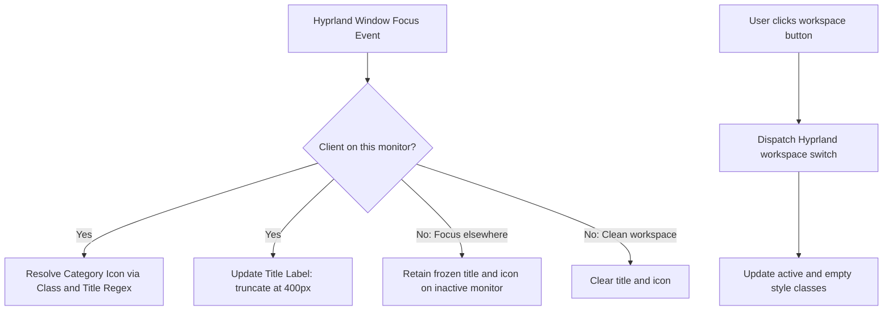
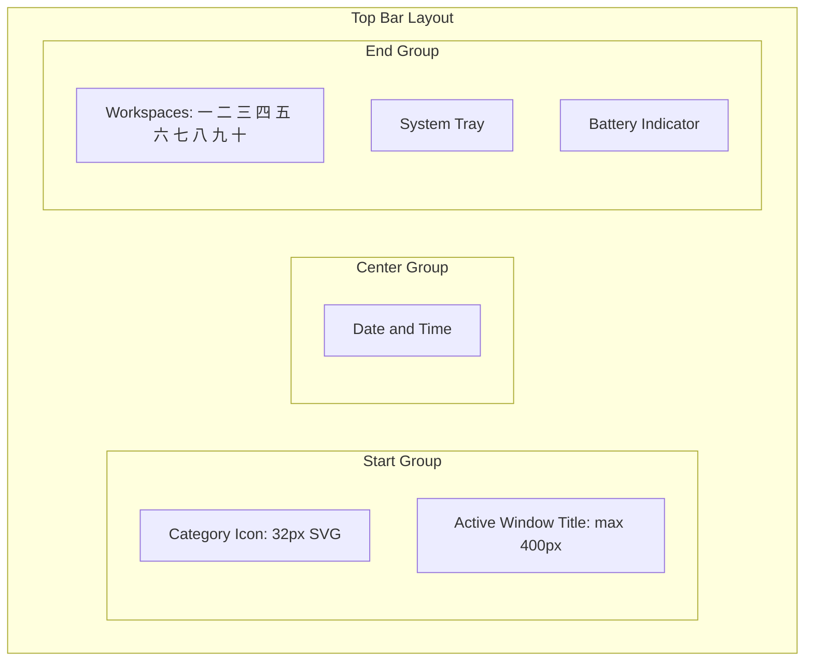

<!-- markdownlint-disable MD033 -->

# 004: Workspace Tray

- **Status:** **Accepted**
- **Date:** 2026-10-24
- **Author(s):** [João V. Farias](https://github.com/BeyondMagic)

## Context

The workspace tray manages per-monitor virtual desktop navigation and active application metadata. Migrated from the legacy Astal implementation in `lovemii`, it combines Kanji workspace numbering, categorized window icons, title tracking, and display corner rounding masks into a cohesive Wayland top bar.

## Benchmark

### Legacy `lovemii` Astal Shell

The legacy Astal configuration implemented these boundaries across discrete modules:

- `widget/bar/workspaces`: rendered 10 workspaces per monitor labeled with Japanese numerals (`一` through `十`), tracking active and empty states via `AstalHyprland`.
- `widget/bar/icon`: resolved client window classes and titles to custom symbolic SVG icons using a regex mapping table in `config.toml`.
- `widget/bar/title`: displayed the active window title with a 400px width limit, freezing state when focus moved across monitors.
- `widget/corner`: placed four layer-shell overlay windows on each display to draw 32px inverted circular arcs matching the bar background color.

## Interaction Flow



1. **Workspace Navigation:**
   - The bar renders 10 fixed workspace buttons per monitor, labeled `一` to `十`.
   - Workspaces with open windows display an occupied state indicator.
   - The focused workspace displays the active highlight style.
   - Clicking any workspace button triggers `dispatch workspace <id>` via Hyprland IPC.

2. **Window Metadata:**
   - On focus change, the active window class and title are matched against the category dictionary to select the matching symbolic SVG.
   - The title label reflects the active window title up to 400px wide.
   - When focus shifts to another monitor, the inactive monitor freezes its last known title and icon.

3. **Display Corner Masks:**
   - Four dedicated overlay surfaces anchor to the top-left, top-right, bottom-left, and bottom-right corners of each display.
   - Each overlay paints an inverted circular arc with radius 32px and background color `rgba(5, 5, 5, 1)` to provide rounded screen borders.

## Visual Design



## Implementation

### Data Models

```json
{
  "workspaces": {
    "total": 10,
    "labels": ["一", "二", "三", "四", "五", "六", "七", "八", "九", "十"]
  },
  "geometry": {
    "root_size": 16,
    "corner_radius": 32,
    "title_max_width": 400,
    "background_color": "rgba(5, 5, 5, 1)"
  }
}
```

### Application Icon Categories

Window classes map to symbolic SVGs stored under `assets/hicolor/scalable/apps/`:

| Target Symbolic Icon | Sample Matching Window Classes |
| :--- | :--- |
| `command-terminal` | `foot` |
| `internet-browser` | `firefox`, `firefox-nightly`, `google-chrome` |
| `social-media` | `org.telegram.desktop`, `vesktop` |
| `email-manager` | `thunderbird`, `org.gnome.Evolution` |
| `movie-streaming` | `com.stremio.stremio` |
| `code-editor` | `Code`, `code`, `jetbrains-idea` |
| `digital-art-tool` | `krita`, `gimp` |
| `any-book-reader` | `org.pwmt.zathura`, `com.github.johnfactotum.Foliate`, `sioyek` |
| `any-flashcard-learning-tool` | `anki` |
| `japanese-character-phrase` | `dakanji`, `DaKanji` |
| `tool-notetaking` | `obsidian` |
| `tool-file-explorer` | `xdg-desktop-portal-gtk` |

### Quickshell Components

- **Workspaces:** implemented via `Quickshell.Hyprland` workspace bindings, mapping workspace index 1–10 to Kanji strings.
- **Active Title & Icon:** binds to active window properties via Hyprland IPC. Regex matching is evaluated in QML or a lightweight JavaScript helper.
- **Screen Corner Masks:** implemented as four `PanelWindow` items positioned at display corners, using QML `Canvas` or `Shape` with `PathArc` to render the inverted corner mask.
