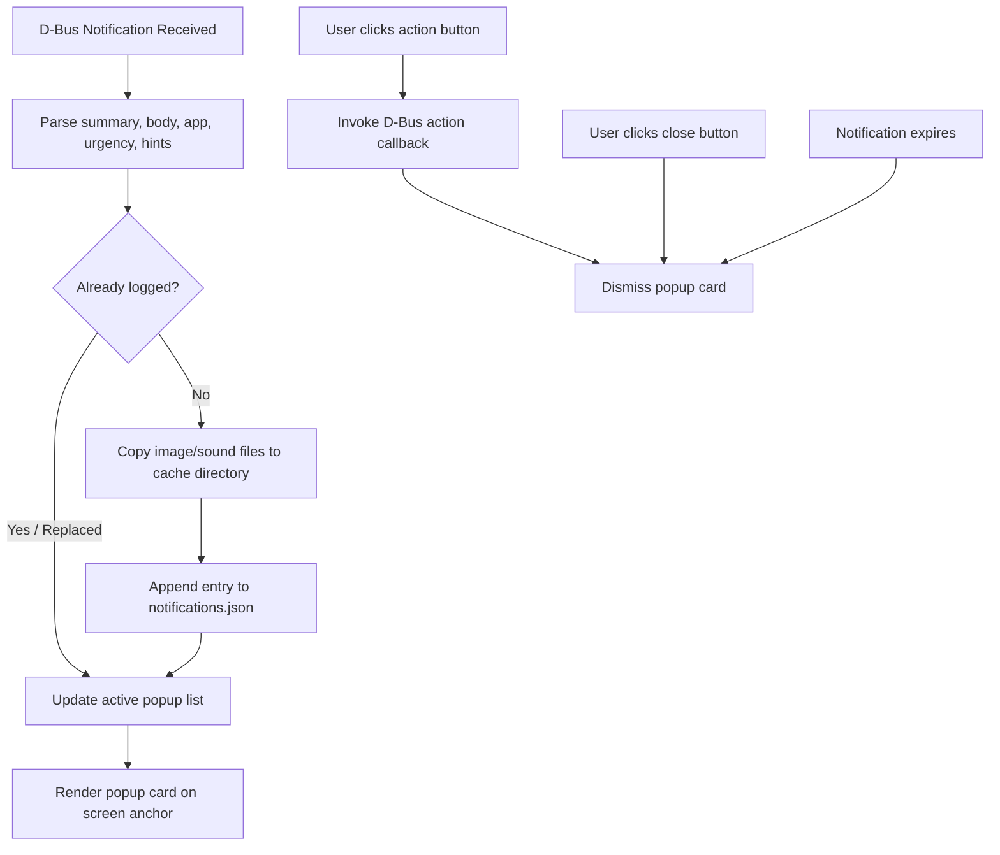

<!-- markdownlint-disable MD033 -->

# 005: Notifications

- **Status:** **Accepted**
- **Date:** 2026-10-24
- **Author(s):** [João V. Farias](https://github.com/BeyondMagic)

## Context

Standard notification daemons drop incoming messages once dismissed, and sending applications frequently clean up temporary media files, causing broken image and sound references in notification logs. Users miss past messages or lose track of alerts that expired while away from the screen. The notification service displays interactive popups anchored to the screen edge and maintains an append-only historical log with isolated media assets in the local cache.

<!--
AI Agent Context & Architecture:
- Legacy reference: `lovemii` astal implementation (`widget/notification/`, `services/notifications.ts`).
- D-Bus interface: `org.freedesktop.Notifications`.
- Media isolation: Incoming image paths are copied to `$XDG_CACHE_HOME/notifications/images/` and sounds to `$XDG_CACHE_HOME/notifications/sounds/` before external senders delete temporary source files.
-->

## Interaction Flow



1. **Notification Arrival:**
   - The desktop receives notifications over D-Bus (`org.freedesktop.Notifications`).
   - If a notification replaces an existing ID, the visible popup card updates its text and actions in place.
   - New notifications append to the active on-screen popup stack.

2. **Asset Isolation and Persistence:**
   - The persistence service verifies whether the notification was previously recorded.
   - Any local image referenced by absolute file path is copied into the local cache directory.
   - Any audio file referenced by path is copied into the local sounds cache directory.
   - The complete notification record (timestamp, sender application, icon, summary text, body content, urgency level, action identifiers, and isolated media paths) is written to disk.

3. **User Interaction:**
   - Clicking an action button triggers the corresponding D-Bus callback and dismisses the popup.
   - Clicking the dismiss button removes the card from the screen without triggering action callbacks.
   - Non-critical notifications dismiss automatically after their timeout duration expires. Critical notifications remain visible until dismissed by user action.

## Visual Design

<!-- Figma visual design export placeholder -->


## Implementation

### Directory Structure

```text
$XDG_CACHE_HOME/notifications/
├── notifications.json
├── images/
│   └── image-42-20261024223000-album-art.png
└── sounds/
    └── sound-42-20261024223000-alert.ogg
```

### Data Schema

```json
{
  "id": 42,
  "time": 1792881000,
  "appName": "Spotify",
  "appIcon": "spotify",
  "desktopEntry": "spotify",
  "summary": "Now Playing",
  "body": "Artist Name - Track Name",
  "category": "music",
  "urgency": 1,
  "imagePath": "/home/terra/.cache/notifications/images/image-42-20261024223000-art.png",
  "imageIcon": null,
  "soundPath": null,
  "soundName": null,
  "actions": [
    { "id": "next", "label": "Next Track" }
  ]
}
```

### Quickshell Components

- **Popup Surface:** `PanelWindow` anchored to `Edge.Top | Edge.Right` on the Wayland `Overlay` layer with `exclusiveZone: 0` so it hovers above application windows.
- **Service Integration:** `Quickshell.Services.Notifications` or custom D-Bus service receiving notifications.
- **Persistence Helper:** QML JavaScript module or external script ensuring storage directories exist, copying binary assets, and writing JSON entries without blocking the UI thread.
