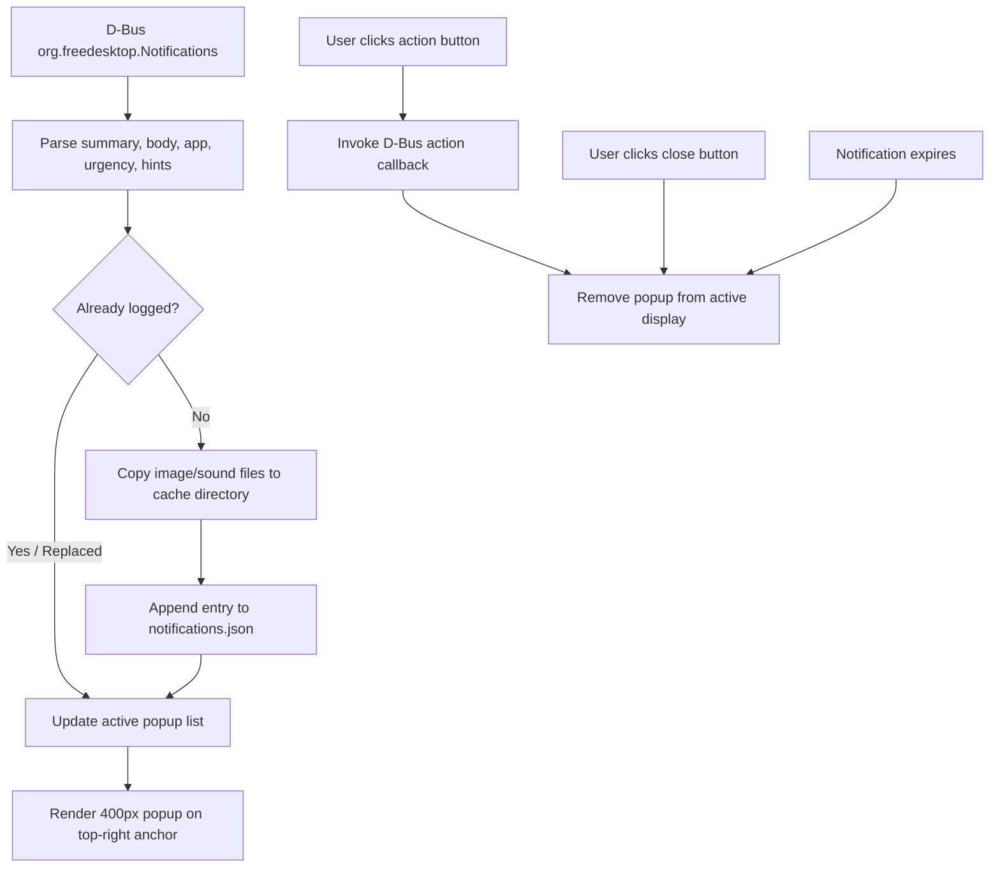
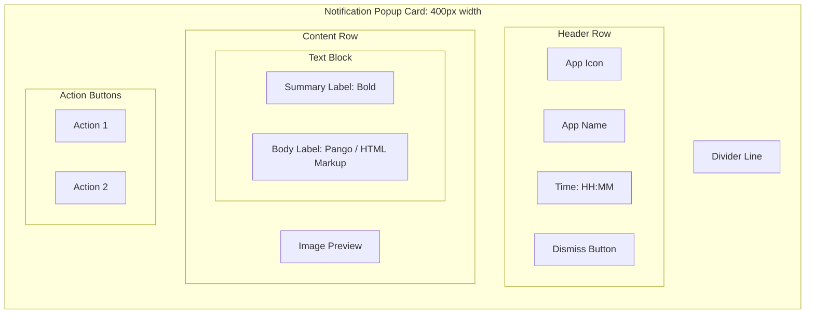

<!-- markdownlint-disable MD033 -->

# 005: Notifications

- **Status:** **Accepted**
- **Date:** 2026-10-24
- **Author(s):** [João V. Farias](https://github.com/BeyondMagic)

## Context

The notification subsystem receives desktop notifications from D-Bus, renders interactive visual popups anchored to the top-right of the display, and stores an append-only historical log with isolated binary assets under `$XDG_CACHE_HOME/notifications`.

## Benchmark

### Legacy `lovemii` Astal Shell

The legacy configuration provided notification handling across two core layers:

- `widget/notification/index.tsx` and `util.tsx`: rendered 400px clamped cards on the Wayland top-right anchor using `AstalNotifd`. Displayed application icons, app names, relative timestamps, rich markup body text, previews for image attachments, and actionable buttons. Cards were styled according to urgency levels: `low` (0), `normal` (1), and `critical` (2).
- `services/notifications.ts`: persisted incoming notifications to `$XDG_CACHE_HOME/notifications/notifications.json`. To prevent dead links when sending apps cleaned up temporary files, it copied binary image attachments into `images/` and audio files into `sounds/` using deterministic timestamped filenames (`image-<id>-<timestamp>-<basename>`).

## Interaction Flow



1. **Notification Arrival:**
   - The shell receives notifications via D-Bus (`org.freedesktop.Notifications`).
   - If a notification replaces an existing ID, the active card updates in place.
   - New notifications are added to the active popup stack.

2. **Asset Isolation & Persistence:**
   - The persistence service checks if the notification ID was already recorded.
   - Any local image referenced by absolute file path is copied into `$XDG_CACHE_HOME/notifications/images/`.
   - Any audio file referenced by sound path is copied into `$XDG_CACHE_HOME/notifications/sounds/`.
   - The notification record (timestamps, app name, icon, summary, body, urgency, action identifiers, and preserved media paths) is written to `notifications.json`.

3. **User Interaction:**
   - Clicking an action button invokes the corresponding D-Bus action callback and dismisses the card.
   - Clicking the close button (`window-close-symbolic`) dismisses the notification.
   - Notifications without critical urgency dismiss automatically upon expiration.

## Visual Design



## Implementation

### Directory Structure

```text
$XDG_CACHE_HOME/notifications/
├── notifications.json
├── images/
│   └── image-42-20261024223000-album-art.png
└── sounds/
    └── sound-42-20261024223000-alert.ogg
```

### Data Schema

```json
{
  "id": 42,
  "time": 1792881000,
  "appName": "Spotify",
  "appIcon": "spotify",
  "desktopEntry": "spotify",
  "summary": "Now Playing",
  "body": "Artist Name - Track Name",
  "category": "music",
  "urgency": 1,
  "imagePath": "/home/terra/.cache/notifications/images/image-42-20261024223000-art.png",
  "imageIcon": null,
  "soundPath": null,
  "soundName": null,
  "actions": [
    { "id": "next", "label": "Next Track" }
  ]
}
```

### Quickshell Components

- **Popup Surface:** `PanelWindow` anchored to `Edge.Top | Edge.Right` with Wayland layer `Overlay` and `exclusiveZone: 0` so it hovers over application windows.
- **Service Integration:** `Quickshell.Services.Notifications` or custom D-Bus service receiving notifications.
- **Persistence Helper:** QML JavaScript module or external Nushell script ensuring `$XDG_CACHE_HOME/notifications` directories exist, copying binary assets, and writing JSON entries without blocking the UI thread.
