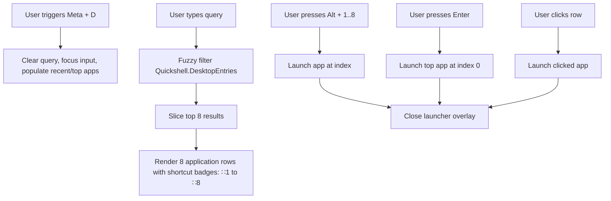
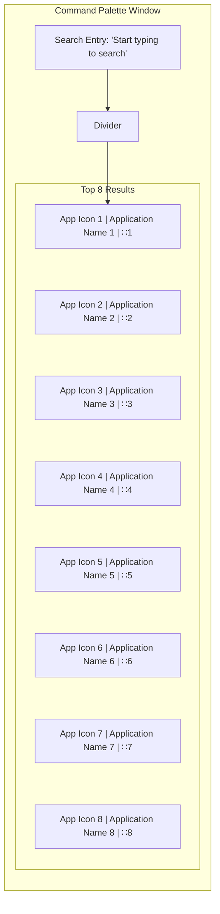

<!-- markdownlint-disable MD033 -->

# 007.1: Desktop Applications

- **Status:** **Accepted**
- **Date:** 2026-10-24
- **Author(s):** [João V. Farias](https://github.com/BeyondMagic)

## Context

The desktop applications provider powers the root search view of the launcher. It indexes installed system and user desktop entries, filters them via fuzzy query matching, and exposes fast keyboard shortcuts (`Alt + 1..8`) to launch target applications immediately.

## Benchmark

### Legacy `lovemii` Astal Launcher

The legacy configuration in `widget/launcher/index.tsx` established the core interaction model:

- Application querying via `AstalApps.Apps()` restricted results to the top 8 matches (`fuzzy_query(text).slice(0, 8)`).
- Visual shortcut badges (`∷1` through `∷8`) aligned to the right side of each result item.
- Keybinding handler in `onKey` intercepting `Alt + 1..8` to execute the corresponding indexed result without navigating the arrow keys.
- Direct keystroke capture: typing any alphanumeric key or backspace while the launcher overlay was open directed input straight into the search entry.

## Interaction Flow



1. **Search & Indexing:**
   - On opening the launcher, the search input gains focus with an empty query.
   - As the user types, the provider fuzzy matches the query against application names, executable names, generic names, and keywords.
   - The result set is capped at 8 items to prevent list clutter and maintain visual consistency with number key shortcuts.

2. **Keyboard Navigation & Execution:**
   - Pressing `Enter` executes the top result (index 0) immediately.
   - Pressing `Alt + 1` through `Alt + 8` executes the matching application row directly.
   - Arrow keys (`Up` / `Down`) or `Tab` / `Shift + Tab` cycle selection through the list.
   - Clicking an application row executes it.
   - Any launch action closes the launcher overlay.

## Visual Design



## Implementation

### Data Schema

```json
{
  "desktop_apps": {
    "max_results": 8,
    "shortcut_prefix": "∷",
    "enable_alt_numeric_shortcuts": true
  }
}
```

### Quickshell Components

- **Application Catalog:** `Quickshell.DesktopEntries` provides the reactive list of installed desktop entries.
- **Fuzzy Filter:** A JavaScript helper scores and ranks entries against the current search string, taking the first 8 items (`slice(0, 8)`).
- **Shortcut Handling:** `Keys.onPressed` on the root container intercepts `Qt.AltModifier` combined with `Qt.Key_1` through `Qt.Key_8` to call `results[index].launch()`.
- **Execution:** Native execution via `desktopEntry.launch()`, delegating process spawning and desktop environment integration directly to Quickshell without intermediary helper scripts.
