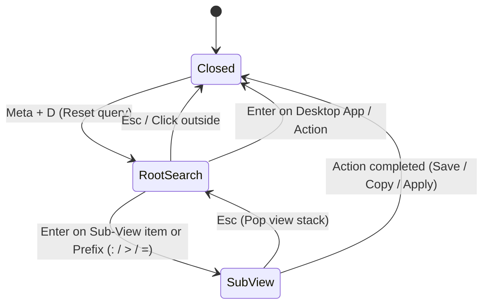

<!-- markdownlint-disable MD033 -->

# 007: Launcher

- **Status:** **Accepted**
- **Date:** 2026-10-24
- **Author(s):** [João V. Farias](https://github.com/BeyondMagic)

## Context

Spawning separate standalone utility windows or typing repetitive CLI flags into terminal windows slows down daily work. Users need a single keyboard shortcut to launch applications, run scripts, and inspect tools without leaving the keyboard. The launcher provides a centered command palette overlay that opens on a unified search and transitions in place into dedicated sub-views.

<!--
AI Agent Context:
- The command palette is resident in memory on the Wayland WlrLayerShell Overlay layer (`visible` toggled via IPC or shortcut for 0ms popup latency).
- Sub-views load into a central StackLayout or Loader container without destroying or recreating Wayland surfaces.
-->

## Benchmark

### [PowerToys Command Palette](https://learn.microsoft.com/en-us/windows/powertoys/command-palette/overview)

### [PowerToys Run utility](https://learn.microsoft.com/en-us/windows/powertoys/run)

## Sub-Views and Providers

| ID    | Provider / Sub-View                                 | Prefix | Backend / Source                             | Status       |
| :---- | :-------------------------------------------------- | :----- | :------------------------------------------- | :----------- |
| 007.1 | [Desktop Applications](./001-desktop-apps.md)       | None   | `Quickshell.DesktopEntries`                  | **Accepted** |
| 007.2 | [Collected Words](./002-collected-words.md)         | `>`    | `~/.config/nushell/scripts/quotes.nu`        | **Accepted** |
| 007.3 | [Emoji and Kaomoji Picker](./003-emojis.md)         | `:`    | `~/.config/nushell/scripts/emojis.nu`        | Planned      |
| 007.4 | [Service Manager](./004-service-manager.md)         | `>`    | `dinitctl.nu` / Tailscale SSH                | Planned      |
| 007.5 | [Calculator](./005-calculator.md)                   | `=`    | `qalc` / `libqalculate`                      | Planned      |
| 007.6 | [Wallpaper Picker](./006-wallpaper-picker.md)       | `>`    | `~/.config/nushell/scripts/wallpaper.nu`     | Planned      |
| 007.7 | [Screen OCR](./007-ocr.md)                          | `>`    | `grim` + `slurp` + `tesseract` / `RapidOCR`  | Planned      |
| 007.8 | [Dictionary](./008-dictionary.md)                   | `?`    | `dict.nu`                                    | Planned      |

## Interaction Flow

1. **Trigger and Reset:**
   - Pressing `Meta + D` opens the centered overlay on the active monitor.
   - Opening the overlay resets the view stack to the root search view, clears any previous query text, and focuses the search input.

2. **Search and Query Filtering:**
   - Typing in the root search filters desktop applications, system commands, and built-in sub-views using fuzzy matching.
   - Typing a designated prefix (`:` for emojis and kaomojis, `=` for calculator, `>` for script sub-views, `?` for dictionary) switches the provider filter directly.

3. **Keyboard Navigation:**
   - Pressing Up or Down arrow keys, or Tab or Shift+Tab, moves selection through the results list.
   - Clicking any row selects and activates that item.

4. **Execution and View Transitions:**
   - Pressing Enter on a desktop application launches the program and closes the launcher overlay.
   - Pressing Enter on a sub-view entry replaces the root search list in place with that sub-view.
   - Pressing Escape inside any sub-view pops the navigation stack back to the root search view.
   - Pressing Escape in the root search view, or clicking outside the palette window, closes the launcher.

## Visual Design

<!-- Figma visual design export placeholder -->

## Implementation

- **Window Layer:** Resident `PanelWindow` on the Wayland `WlrLayerShell` Overlay layer (`visible` toggled via IPC or shortcut for 0ms popup latency) with exclusive keyboard focus while visible.
- **View Stack:** A central `StackLayout` or `Loader` inside the launcher container switches between the root search list and the active sub-view component without creating new Wayland windows.
