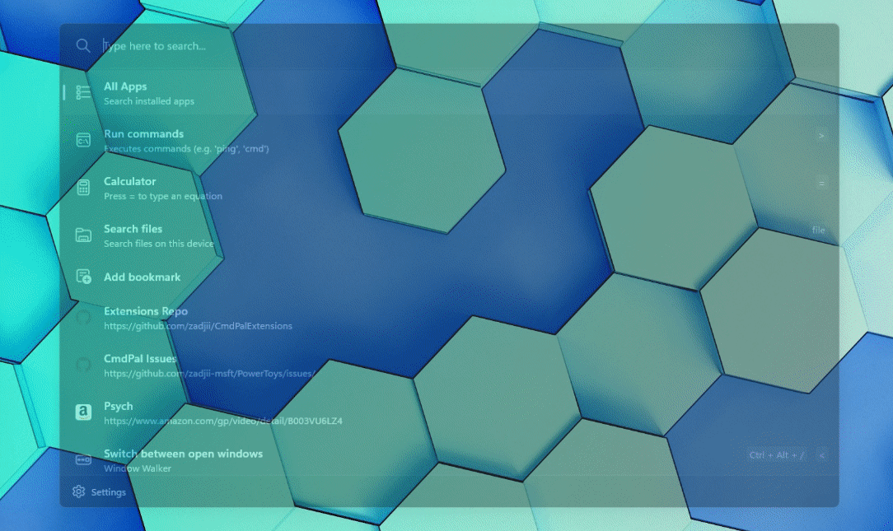
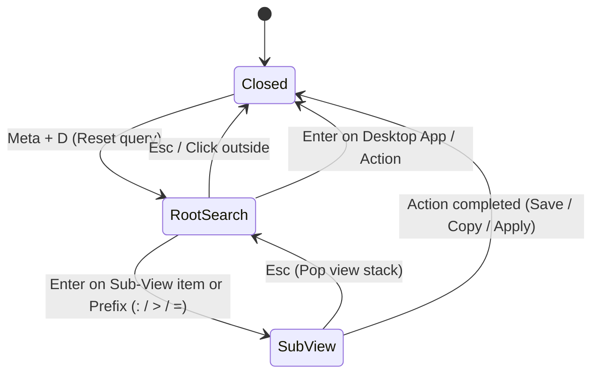

<!-- markdownlint-disable MD033 -->

# 007: Launcher

- **Status:** **Accepted**
- **Date:** 2026-10-24
- **Author(s):** [João V. Farias](https://github.com/BeyondMagic)

## Context

The launcher is the central keyboard-driven command palette for `WISP`. Rather than spawning separate standalone utility windows or forcing the user to type repetitive CLI flags in a terminal, it provides a single overlay window that starts on a unified root search and transitions in-place into specialized sub-views.

## Benchmark

### [PowerToys Command Palette](https://learn.microsoft.com/en-us/windows/powertoys/command-palette/overview)

### [PowerToys Run utility](https://learn.microsoft.com/en-us/windows/powertoys/run)

## Sub-Views and Providers

| ID    | Provider / Sub-View                                 | Prefix | Backend / Source                             | Status       |
| :---- | :-------------------------------------------------- | :----- | :------------------------------------------- | :----------- |
| 007.1 | [Desktop Applications](./001-desktop-apps.md)       | None   | `Quickshell.DesktopEntries`                  | **Accepted** |
| 007.2 | [Collected Words](./002-collected-words.md)         | `>`    | `~/.config/nushell/scripts/quotes.nu`        | **Accepted** |
| 007.3 | [Emoji and Kaomoji Picker](./003-emojis.md)         | `:`    | `~/.config/nushell/scripts/emojis.nu`        | Planned      |
| 007.4 | [Service Manager](./004-service-manager.md)         | `>`    | `dinitctl.nu` / Tailscale SSH                | Planned      |
| 007.5 | [Calculator](./005-calculator.md)                   | `=`    | `qalc` / `libqalculate`                      | Planned      |
| 007.6 | [Wallpaper Picker](./006-wallpaper-picker.md)       | `>`    | `~/.config/nushell/scripts/wallpaper.nu`     | Planned      |
| 007.7 | [Screen OCR](./007-ocr.md)                          | `>`    | `grim` + `slurp` + `tesseract` / `RapidOCR`  | Planned      |
| 007.8 | [Dictionary](./008-dictionary.md)                   | `?`    | `dict.nu`                                    | Planned      |

## Interaction Flow

1. Pressing `Meta + D` opens the centered overlay on the active monitor, resets the view stack to the **Root Search** view, clears any prior query, and focuses the search input.
2. Typing in the root search filters both desktop applications and built-in sub-views/commands using unified fuzzy matching, while automatically evaluating mathematical expressions inline.
3. Typing an optional prefix (`:` for emojis/kaomojis, `=` for calculator, `>` for script sub-views, `?` for dictionary) filters directly to that provider.
4. Pressing `Up` / `Down` or `Tab` / `Shift + Tab` moves selection through the results list.
5. Pressing `Enter` on a desktop application launches it and closes the launcher. Pressing `Enter` on a sub-view item (such as [Collected Words](./002-collected-words.md)) replaces the root list in-place with that sub-view.
6. Pressing `Esc` inside any sub-view pops the navigation stack back to the Root Search view. Pressing `Esc` on the Root Search view (or clicking outside the palette frame) closes the launcher.

## Visual Design

Provide visual design mockups or wireframes of the root command palette frame in Figma.

## Implementation

- **Window Layer:** Resident `PanelWindow` on the Wayland `WlrLayerShell` Overlay layer (`visible` toggled via IPC/shortcut for `0ms` popup latency) with exclusive keyboard focus while visible.
- **View Stack:** A central `StackLayout` or `Loader` inside the launcher container switches between the root search list and the active sub-view component without creating new Wayland windows.
